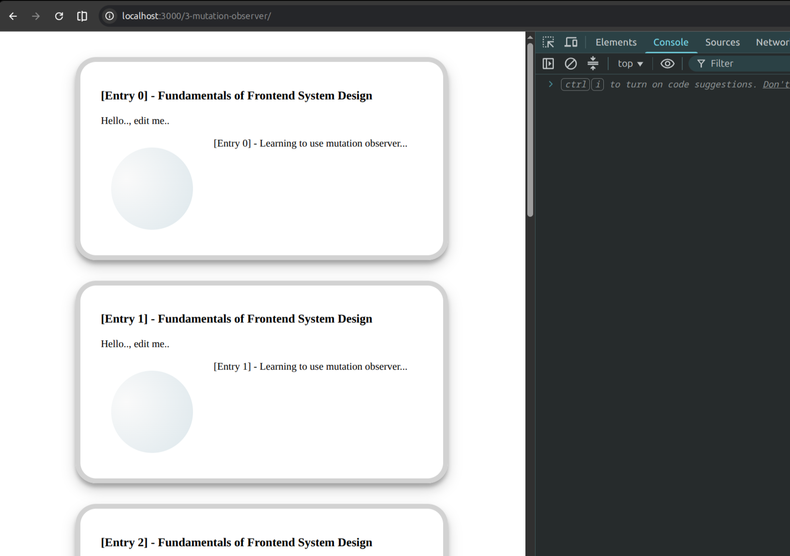
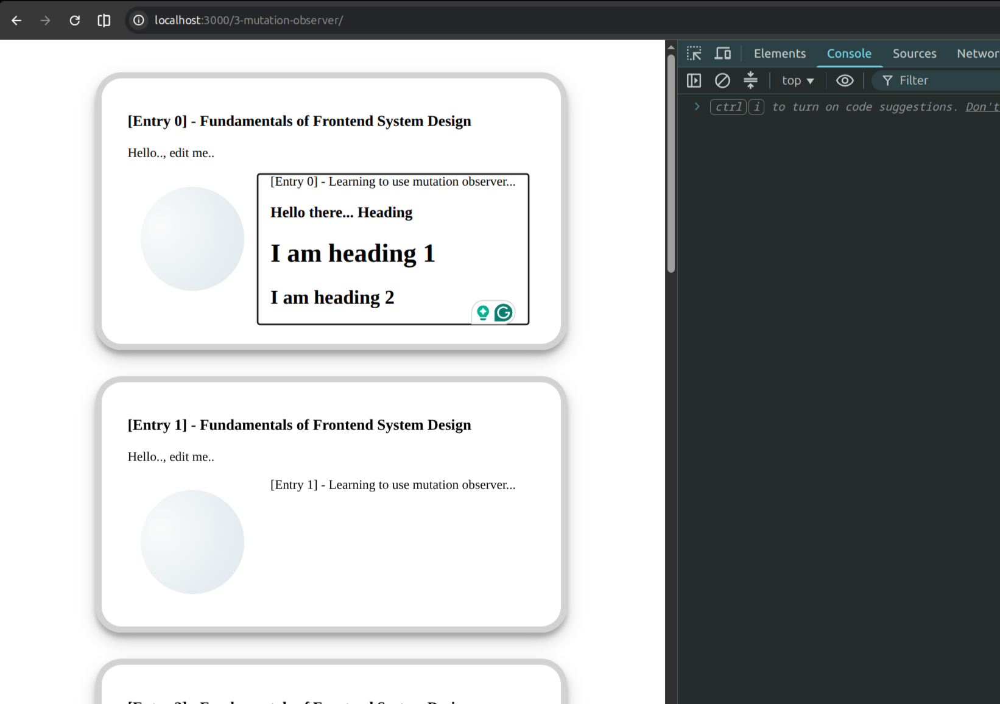

# Mutation Observer

## Overview

Engineers over the years on the Frontend has a pain about the observer topic. Therefore they put a lot of effort and added the Observer API

The mental map

- Observer: Watch for the changes and callback as necessary on the following
  - Intersection: Used for infinite scroll, Interactive UI
  - Mutation: Drawing tool, Rich text editor changes
  - Resize: Updating the UI on resize i.e. charting UI for the stocks, drawing tools,

## Situation

Learning the basics of Mutation observer API in the JS/browser. It has been added since 2016.

## Task

Create a demo that observes a section element in the card with the attribute set to `contenteditable`. When the section is edited with supported `header` tag. for example `/h1` then the callback takes the target of `characterData` and replace the text with `<header1>` tag.

## Actions

- Select the HTML element that should have mutation observer.
- Observe the element as target node with config of `{type: characterData, subtree: true}`
- Create a new instance of mutation observer that will loop on all mutation entries
- Destruct the `type, target` from each mutation
- if type matches the observed type set earlier in the config
  - Create a corresponding element with given content
  - Replace the element in th DOM with newly created element
  - Bring the focus to new element.

## Result

As a result we will have an HTML element that can be edited inline. When edited with supported element type. Content is formatted and replaced accordingly.

## Sample output

### Begin:

### End:

