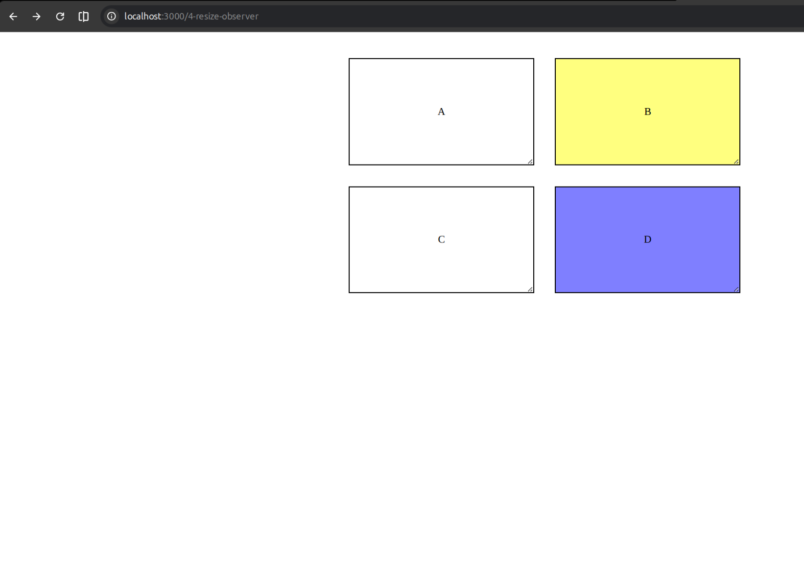
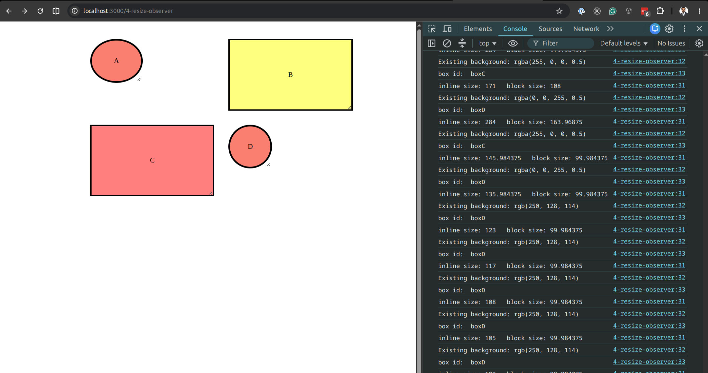

# Resize Observer

## Overview

Engineers over the years on the Frontend has a pain about the observer topic. Therefore they put a lot of effort and added the Observer API

The mental map

- Observer: Watch for the changes and callback as necessary on the following
  - Intersection: Used for infinite scroll, Interactive UI
  - Mutation: Drawing tool, Rich text editor changes
  - Resize: Updating the UI on resize i.e. charting UI for the stocks, drawing tools,

## Situation

Learning the basics of Resize observer API in the JS/browser.

## Task

Create a demo that has a resize observer element for the boxes inside a div. Update the style of boxes on resize

- convert to circle when less than 150px;
- unset the circle style when more than 150px

## Actions

1. Initiate Resize observer
2. Implement callback - use inlineSize and blockSize of the entries for width and height
3. If width and height is less than 150px
   3.1 - Apply border-radius: 100%
   3.2 - Apply border-width: 4px
4. If width and height is more than 150px = unset the properties above
5. All 4 boxes should use same observer

## Result

As a result we will have a div with four boxes with the ability to resize their shape dynamically using resize observer.

## Sample output

### Begin:

### End:

